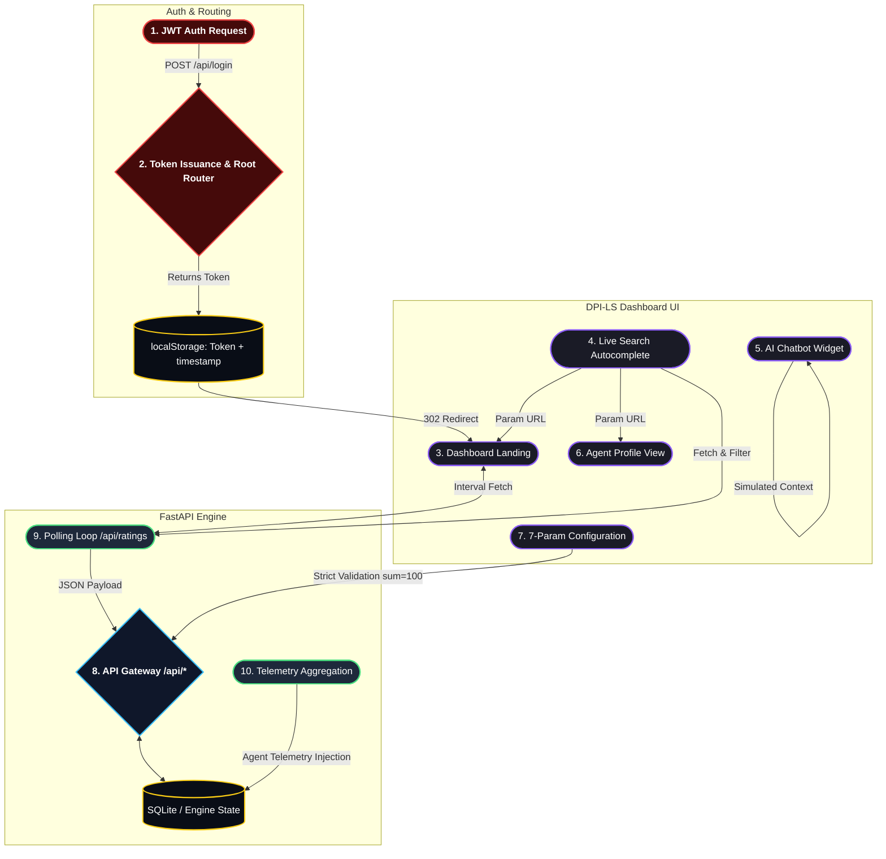

<div align="center">

# DPI-LS Technical Architecture & Implementation Documentation

<p align="center">A comprehensive enterprise-grade technical solution by Intelligenz IT.</p>

<p align="center">
<a href="https://intelligenzit.com/"></a>
<a href="https://www.linkedin.com/company/intelligenz-it/"></a>
</p>

</div>

---

## Technical Overview

The DPI-LS platform is an agent-agnostic evaluation engine and observability dashboard built on a FastAPI Python backend with a vanilla JavaScript/HTML frontend. It leverages an event-driven architecture to compute a 7-dimensional heuristic matrix based on raw telemetry data pushed from AI agents.

## Recent Technical Upgrades (Frontend & Backend)

The platform has undergone a major **UI/UX and Backend Architecture Overhaul** to transition into a dark-themed, enterprise-ready dashboard with enhanced stability, performance, and security.

### 1. Universal Layout & Routing
* **Dark Theme Standard**: Deprecated old color schemes in favor of a unified `#090d16` and `#0f172a` deep-space dark theme across all views.
* **Unified Sidebar Navigation**: Reordered and strictly locked the sidebar navigation: `Dashboard` -> `Onboard Agent` -> `Configuration` -> `Rating` -> `Profile` -> `Resources` -> `Sign Out`.
* **Login Tracker**: Embedded a persistent session tracker securely bound to `localStorage`.

### 2. Intelligent Search & Table Filtering
* **Global Search Component**: Added a persistent top header with a search bar.
* **Live In-Place Filtering**: Overhauled the `demo.html` Search Bar to dynamically filter the Dashboard table rows in real-time, instantly isolating specific Agent IDs without requiring a page redirect.

### 3. Dynamic Onboarding & Configuration
* **Async Agent Onboarding**: Overhauled the `onboarding.html` submission logic. Resolved an SMTP hanging bug by executing the backend fetch asynchronously, enabling an instant redirect to the configuration page.
* **Strict 100% Weightage Validation**: The Configuration UI dynamically accepts all 7 dimensions (P, Q, E, G, R, C, V) and enforces strict mathematical validation ensuring the total weight equals exactly 100 before saving to the database.

### 4. Backend Stability & Performance
* **N+1 Query Resolution**: Identified and resolved a severe SQL bottleneck in `api/scoring.py` that caused the dashboard to take >2.5 minutes to load. By applying `.limit()` constraints to historical event logs, API response times dropped from ~160 seconds to ~0.3 seconds.
* **Database Pooling & WAL Mode**: Hardened the `store/db.py` SQLite implementation by enabling Write-Ahead Logging (WAL) and increasing connection pool sizes to prevent `HTTP 500` crashes under concurrent traffic.

## Technical Architecture (The Push System)

The updated end-to-end technical workflow, reflecting the removal of deprecated features (KRA/Customer Feedback) and the introduction of the new global utilities (Search/Chatbot), follows this architecture:



## AI Agent Integration Model

The engine is **agent-agnostic**. It exposes webhooks and REST endpoints that consume a canonical `AgentObservation` JSON schema.
Supported integrations via `POST /api/metrics/export`:
- OpenAI Agents SDK
- LangGraph, LangChain, CrewAI, AutoGen, LlamaIndex
- Raw HTTP telemetry pushes

## Deployment

Deploy using Uvicorn (Development) or Docker Compose (Production):
```bash
uv run uvicorn api.app:app --host 0.0.0.0 --port 8000
```
```bash
docker compose up -d
```

## About Intelligenz IT

Website: https://intelligenzit.com/  
LinkedIn: https://www.linkedin.com/company/intelligenz-it/

